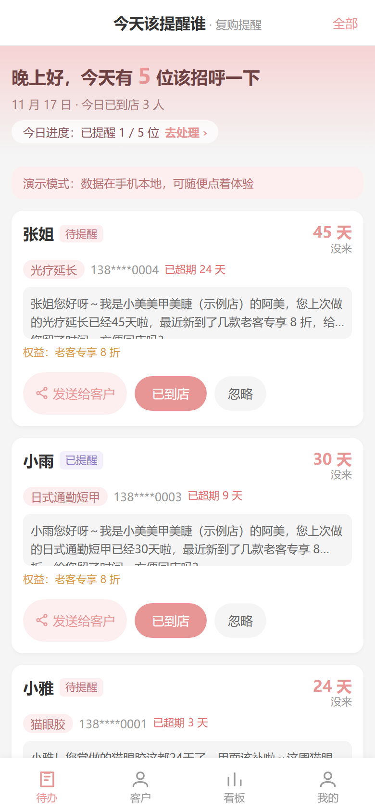
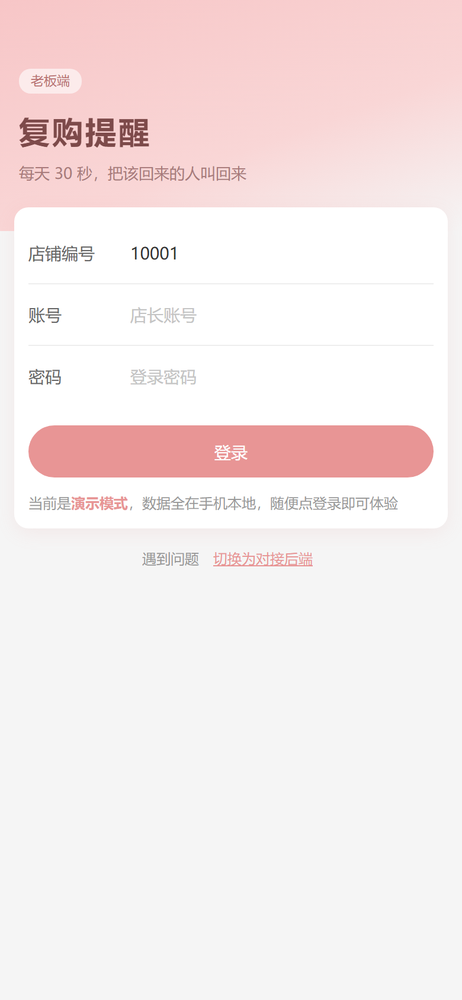
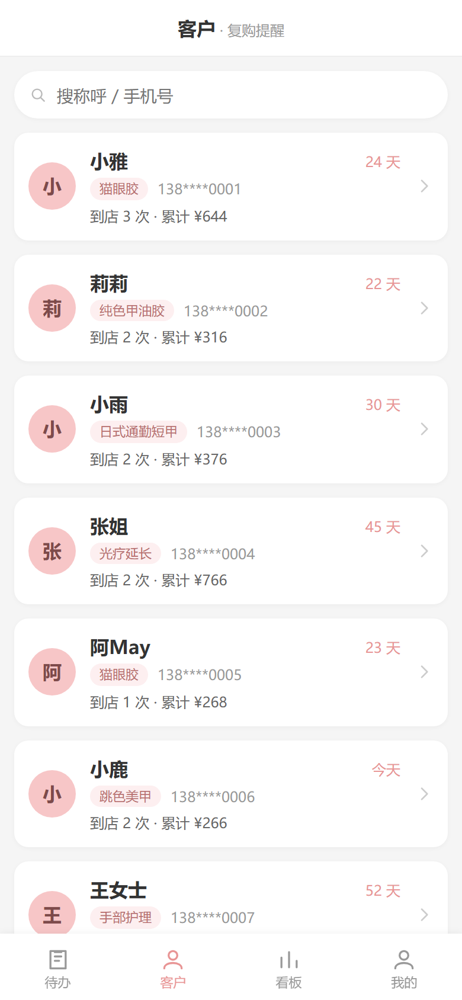
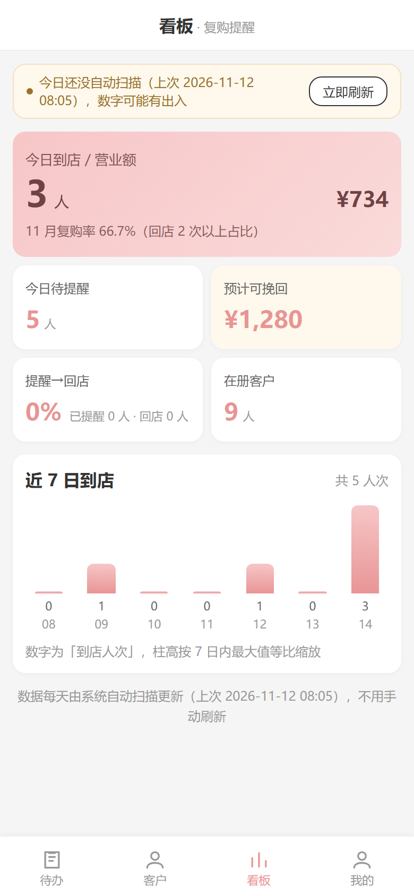

# Repeat Reminder · 门店复购提醒 H5

> 老板每天用手机打开，看一眼「今天该提醒谁」，复制话术发微信，30 秒一个人。
> 一个刻意做窄的移动端：只解决复购提醒这一件事。

> 视频讲解 @抖音「阿龙做系统落地」 · 深度教程 @公众号「soft零壹零」


<p align="center">
  
</p>

| 登录 | 客户 | 看板 |
|:---:|:---:|:---:|
|  |  |  |

---

## 它解决什么问题

小微门店（美甲美睫、推拿理疗、摄影工作室……）最值钱的钱在老客复购，但老板没精力挨个记「谁该回来了」。

市面上的 CRM 都在教老板「管客户」，可老板不想管客户，只想每天花三十秒把该发的消息发出去。

这个 H5 只做一条动线：

```
早上打开 → 看到今天该联系谁（系统按规则算好的）
         → 点一下复制话术
         → 粘贴到微信发出去
         → 客人到店，顺手录一笔
```

**是**：一条极窄的日常动线，手机浏览器打开就能用。

**不是**：不是后台管理系统。刻意不做用户/角色/日志/系统设置，不做复杂表格，不做 PC 适配，不接支付与微信授权。

---

## 快速开始

无需后端、无需配置，自带 mock 数据：

```bash
pnpm install          # 或 npm install
pnpm dev              # 打开 http://localhost:3008
```

登录页随便填账号密码即可进入（mock 模式不校验）。

打包：

```bash
pnpm build            # 产物在 dist/
```

---

## 页面一览

| 路由 | 页面 | 做什么 |
|------|------|--------|
| `/login` | 登录 | 店铺账号登录，带图形验证码 |
| `/today` | 今天该提醒谁 | 首页。按规则算出的今日待联系客户，一键复制话术 |
| `/recall` | 待跟进 | 已提醒未到店的客户，按超期天数排序 |
| `/checkin` | 录到店 | 客人到店后录一笔，自动关闭待办 |
| `/customers` | 客户 | 客户档案列表，支持搜索 |
| `/customer/:id` | 复购档案 | 单客历史：到店记录、提醒记录、复购周期 |
| `/rules` | 提醒规则 | 按项目设置间隔天数与话术模板 |
| `/dashboard` | 看板 | 今日到店人数、金额、复购率、待跟进趋势 |
| `/mine` | 我的 | 店铺信息、数据概览、退出登录 |

底部只有四个 Tab：待办 / 客户 / 看板 / 我的。再多就是负担。

---

## 技术栈

| 层 | 选型 | 为什么 |
|----|------|--------|
| 框架 | Vue 3.5 + `<script setup>` | — |
| 构建 | Vite 7 | 冷启动快，产物小 |
| 路由 | vue-router 4（hash 模式） | 微信/QQ 内置浏览器对 history 模式的子目录部署不友好，hash 更稳 |
| 请求 | axios | 单文件封装，含 token 刷新与 401 兜底 |
| 样式 | 原生 CSS 变量 | 不引 UI 框架，首屏体积优先。整包 gzip 后 < 90KB |

**刻意不用**：TypeScript、Element Plus、Tailwind、Pinia。这个体量的应用不需要它们，引入后收益小于成本。

---

## 目录结构

```
boss-h5/
├── src/
│   ├── api/           # 接口层，按业务域拆分（auth/board/task/customer/visit/rule/shop）
│   ├── components/    # BottomTab / NavBar / TaskCard / CopyButton / EmptyState / ScanAlert
│   ├── mock/          # 假数据与请求拦截，dev 环境零后端可跑
│   ├── router/        # 路由表，meta.tab 控制底部 Tab 显隐
│   ├── styles/        # base.css（重置）+ theme.css（主题变量）
│   ├── utils/         # storage（token/店铺ID 落地）、格式化
│   └── views/         # 9 个页面
├── .env               # 通用变量
├── .env.development   # 开发：走 mock
└── .env.production    # 生产：关 mock，配 API 前缀
```

---

## 接自己的后端

默认 `VITE_USE_MOCK = true`，走 `src/mock/` 的拦截器，不发真实请求。

接真实接口只需三步：

1. `.env.development` 里把 `VITE_API_URL` 指向你的服务，`VITE_API_PROXY_URL` 配代理目标
2. `VITE_USE_MOCK` 改成 `false`
3. 按 `src/api/*.js` 里的注释对齐响应结构

接口约定：

- 响应体 `{ code, message, data }`，`code === 200` 视为成功
- 鉴权头 `Authorization: Bearer <token>`
- 多店铺场景建议在请求头带上店铺标识，服务端据此隔离数据
- `code === 401` 时前端清登录态并跳回登录页

所有接口路径集中在 `src/api/` 下，一个业务域一个文件，改动面收敛。

---

## 设计取舍

几个刻意的决定，供参考：

**为什么只有四个 Tab**
老板不需要「工作台」「消息中心」「审批」一整套。四个入口刚好覆盖一条完整动线：看今天该找谁 → 查客户 → 看数字 → 管自己。

**为什么话术要「复制」而不是「发送」**
微信没有开放给 H5 的发送接口。与其做半吊子的自动化（还有封号风险），不如把「复制到剪贴板」做到极致 —— 点一下，粘贴即发。这是流程最短的合法路径。

**为什么录到店放在流程末端**
录一笔的门槛必须低于「不录」。放在客人到店这个真实场景里，顺手一点，数据才有人维护。

**为什么不做 PC 版**
老板不会坐在电脑前做复购提醒。做了也是死代码。

---

## 适合谁用

- 想给自己门店做一套轻量复购工具的老板
- 想研究「极窄场景移动端」怎么写的开发者
- 需要一个现成的 Vue3 + Vite H5 骨架做二次开发

如果是后者，直接把 `src/views/Today.vue` + `src/api/task.js` 换成你的业务即可，其余骨架可以原样保留。

---

## 后续可做

- [ ] 微信服务号模板消息触达（需公众号资质）
- [ ] 客户标签与分层话术
- [ ] 数据导出 CSV
- [ ] PWA 离线可用

欢迎提 Issue 讨论，也欢迎直接 PR。

---

## License

MIT
